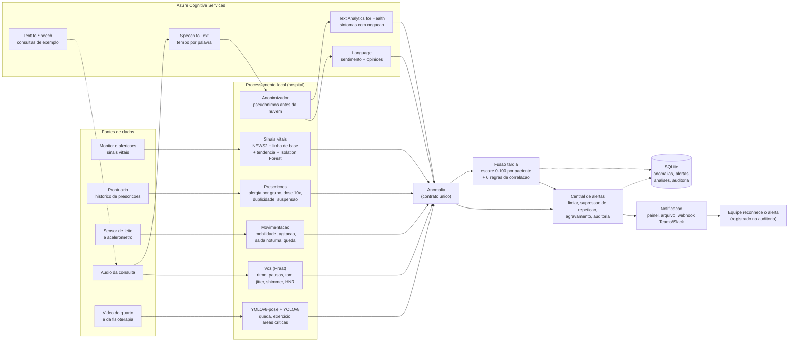

# Relatório Técnico — Monitoramento Multimodal do Paciente

**Tech Challenge Fase 4 — FIAP, IA para DEVS**

> Projeto acadêmico. Pacientes, prontuários, prescrições e consultas são sintéticos. Os sinais vitais, vozes e vídeos reais vêm de datasets públicos citados na seção 3. Nada aqui representa conduta médica real.

---

## 1. O desafio e a decisão de arquitetura

A Fase 3 entregou um assistente clínico que lê laudos, prontuários e protocolos. A Fase 4 pede que o hospital passe a **monitorar o paciente continuamente** por áudio, vídeo e texto, detecte sinais precoces de risco e alerte a equipe em tempo real, integrando serviços gerenciados da Azure.

O projeto da Fase 3 foi estendido, não reescrito. O banco do hospital, a anonimização, a auditoria, o painel e as regras clínicas continuam valendo. O monitoramento é um pacote novo, `assistente_medico/multimodal/`, que conversa com eles.

A decisão central é a mesma da Fase 3: **separar o que precisa ser verdadeiro do que pode ser estimado**. Cada modalidade tem um detector próprio, com critério explícito e avaliado separadamente. A combinação entre modalidades vem depois, numa **fusão tardia** (no nível de decisão), que também é explícita. Nenhum modelo opaco decide sozinho que um paciente está em risco. Toda decisão tem evidência citável, e todo alerta tem trilha de auditoria.

| Requisito do enunciado | Onde está | Seção |
|---|---|---|
| Vídeo: processar sessões clínicas, postura (OpenPose) e objetos/áreas (YOLOv8), relatório de desvios | `multimodal/video/` | 4.5 |
| Áudio: consultas, alterações vocais, Azure Speech to Text, Azure Text Analytics | `multimodal/audio/`, `multimodal/azure/` | 4.4, 5 |
| Anomalias em sinais vitais (séries temporais) | `multimodal/anomalias/sinais_vitais.py` | 4.1 |
| Anomalias na evolução de prescrições | `multimodal/anomalias/prescricoes.py` | 4.2 |
| Anomalias nos padrões de movimentação durante a internação | `multimodal/anomalias/movimentacao.py` | 4.3 |
| Alertas automáticos à equipe | `multimodal/alertas.py`, aba Monitoramento | 6 |
| Fusão dos tipos de dados | `multimodal/fusao.py` | 4.6 |
| Serviços em nuvem (Azure Cognitive Services) | Speech (STT e TTS) e Language (sentimento e Health) | 5 |

---

## 2. O fluxo multimodal



Fonte do diagrama: [`docs/diagramas/fluxo_multimodal.mmd`](./diagramas/fluxo_multimodal.mmd).

### 2.1 Um contrato único: `Anomalia`

Todo detector, de qualquer modalidade, devolve o mesmo objeto:

| Campo | Exemplo |
|---|---|
| `modalidade` | `sinais_vitais`, `prescricao`, `movimentacao`, `audio`, `texto`, `video`, `multimodal` |
| `tipo` | `desvio_basal_saturacao`, `salto_dose`, `queda`, `voz_disartria`, `video_queda` |
| `severidade` | `critica`, `alta`, `moderada`, `baixa` |
| `descricao` | frase para a equipe, com os números que a sustentam |
| `inicio` / `fim` | intervalo do achado na linha do tempo do paciente |
| `detector` e `evidencias` | o método (por exemplo, `zscore_robusto`) e os valores usados na decisão |

É esse contrato que torna a fusão possível: a central de alertas e a fusão não precisam saber de onde veio o achado.

### 2.2 Tempo real

Os detectores são **online**. Guardam apenas o estado necessário (janela recente, linha de base do paciente, episódio em curso) e decidem a cada leitura que chega, sem reprocessar a série. O `Monitor` (`tempo_real.py`) reproduz um fluxo de leituras respeitando o intervalo real entre elas, com aceleração opcional (`--aceleracao 3600` reproduz uma hora por segundo). Esse contrato é o mesmo que um consumidor de fila (Azure Event Hubs, Kafka, MQTT) usaria em produção.

Para não alertar a cada leitura, os detectores trabalham por **episódio** (`episodios.py`):
- a condição precisa **persistir** por um tempo mínimo antes de abrir o episódio (um pico isolado de artefato não abre);
- o episódio emite na abertura e volta a emitir **só se piorar**;
- ele fecha depois de algumas leituras normais seguidas.

### 2.3 Relógio do cenário

Os prontuários sintéticos têm uma linha do tempo própria. Se o áudio e o vídeo fossem carimbados com a hora real, cairiam semanas depois dos sinais vitais e nenhuma correlação entre modalidades seria possível. Com `RELOGIO=cenario` (padrão), o "agora" é a última aferição registrada no prontuário. Em produção, `RELOGIO=real` usa a hora do sistema.

---

## 3. Dados

Sempre que existia um dataset público adequado, usamos dados reais. Onde não existia (consultas em português, histórico de prescrições), geramos dados sintéticos e declaramos isso.

| Uso | Fonte | Conteúdo | Licença |
|---|---|---|---|
| Sinais vitais reais | PhysioNet **BIDMC** | 53 pacientes de UTI, 8 min a 1 Hz: FC, FR, SpO₂ | ODC-By 1.0 |
| Voz real (qualidade vocal) | PhysioNet **VOICED** | 208 vogais /a/ sustentadas: 57 saudáveis, 151 com patologia vocal | ODC-By 1.0 |
| Queda: acelerômetro e vídeo | **UR Fall Detection** | 30 quedas e 40 atividades do dia a dia, gravadas ao mesmo tempo por acelerômetro e câmera, com rótulo quadro a quadro | CC BY-NC-SA 4.0 |
| Fisioterapia e exercício | **Wikimedia Commons** | meio agachamento (CDC), escada de dedos, agachamento unipodal, afundo alternado | domínio público, CC BY-SA 3.0/4.0 |
| Internação | sintético (`anomalias/sintetico.py`) | 12 pacientes, até 72 h: sinais vitais horários com pressão arterial, prescrições, sensor de leito, com eventos rotulados | — |
| Consultas | **Azure Text to Speech** | 6 relatos de pacientes e 30 áudios de avaliação em pt-BR, com a condição vocal simulada por SSML | — |

`scripts/baixar_datasets.py` baixa tudo para `dados/multimodal/` (fora do Git) e grava, em cada pasta, a origem, a licença e a citação. Para os vídeos do Commons, autor e licença de cada arquivo são consultados na API do próprio Commons.

O AudioSet, também sugerido no enunciado, distribui apenas rótulos e *embeddings* de clipes do YouTube, sem o áudio. Para os nossos objetivos (fala em português e voz com patologia), o VOICED e o TTS da Azure foram mais adequados.

---

## 4. Modelos e técnicas por tipo de dado

### 4.1 Sinais vitais — séries temporais

Quatro camadas online, cada uma cobrindo uma falha das outras:

| Camada | Técnica | O que pega | O que não pega |
|---|---|---|---|
| Limiar | **NEWS2** (Royal College of Physicians, 2017) por parâmetro e agregado | valores perigosos para qualquer paciente | quem sai de FC 70 para 105: continua "normal" para o escore |
| Linha de base | **z-score robusto** (mediana e MAD) contra a janela recente do próprio paciente | mudança brusca dentro da faixa normal | piora lenta |
| Tendência | **inclinação linear** na janela (3 min a 1 Hz; 6 h nas aferições horárias), confirmada por terços | piora gradual, antes de cruzar qualquer limiar | — |
| Multivariada | **Isolation Forest** treinado na linha de base do paciente, em escala robusta | combinação atípica em que nenhum parâmetro isolado chama atenção | — |

Duas proteções sustentam a confiabilidade:
- **Qualidade do sinal.** Valor zero, ausente ou fisiologicamente impossível é tratado como **falha de sensor**: nunca entra nas estatísticas e nunca vira alarme clínico. Desconexões longas viram alerta de equipamento.
- **Linha de base congelada durante a anomalia.** Sem isso, o z-score "aprenderia" a piora e deixaria de vê-la.

Há dois conjuntos de parâmetros: monitor de beira de leito (1 Hz) e aferição de enfermagem (horária).

### 4.2 Prescrições — evolução do tratamento

Cada nova prescrição (ou suspensão) é comparada com o histórico do próprio paciente:

| Regra | Severidade | Observação |
|---|---|---|
| Conflito com alergia registrada | crítica | **por grupo farmacológico**: alergia a penicilina × amoxicilina. A regra textual da Fase 3 só comparava o nome |
| Dose diária 5× ou mais acima ou abaixo da anterior | crítica | perto de 10×, o alerta sugere erro de digitação (vírgula ou zero a mais) |
| Dose diária 2× em menos de 24 h | alta | ignorada para medicamentos tituláveis (noradrenalina, insulina em infusão) |
| Dose acima da tabela de referência | alta | tabela **sintética e didática**, declarada como tal no próprio arquivo |
| Duplicidade terapêutica | alta | dois anticoagulantes ativos ao mesmo tempo |
| Suspensão de medicamento crítico sem substituto | moderada | antimicrobiano, anticoagulante, insulina |

As mensagens descrevem **o que mudou no histórico**; não recomendam conduta nem dose, coerentes com as políticas de limite de atuação da Fase 3 (PROT-GOV-010).

### 4.3 Movimentação durante a internação

| Fonte | Detecção | Critério |
|---|---|---|
| Sensor de leito (15 min) | imobilidade prolongada | mesma posição por 3 h (moderada) ou 5 h (alta); o reposicionamento esperado é a cada 2 h |
| Sensor de leito | agitação noturna | atividade ≥ 3× a linha de base noturna do próprio paciente, por 45 min (rastreio de delirium) |
| Sensor de leito | saída do leito à noite | severidade alta em paciente com risco de queda (≥ 65 anos) |
| Acelerômetro (cintura) | **queda** | pico de aceleração ≥ 3,0 g; a postura após o impacto vai como evidência |

O limiar de 3,0 g foi **calibrado nas sequências ímpares do UR Fall e avaliado nas pares**. Na calibração, exigir postura horizontal depois do impacto não melhorou a separação entre queda e atividade comum, porque deitar rápido na cama também termina na horizontal. Por isso a postura ficou como evidência e não como condição.

### 4.4 Áudio das consultas

```
WAV ─┬─ medidas acústicas locais (Praat/parselmouth) ── comparadas à gravação de base do paciente
     │                                                   └─▶ fadiga · dispneia · disartria
     └─ Azure Speech to Text (tempo por palavra) ─▶ anonimizador local ─▶ Azure Language
                                                                          ├─ sentimento e opiniões
                                                                          └─ Text Analytics for Health
                                                                               └─▶ catálogo de termos críticos
```

**Medidas acústicas** (`audio/acustica.py`), todas locais:
- **temporais**, pelos núcleos silábicos de De Jong & Wempe (2009): taxa de fala, taxa de articulação (sem as pausas), pausas por minuto, duração das pausas, sílabas por grupo respiratório e irregularidade do ritmo;
- **prosódicas**: F0 e sua variação em semitons, intensidade;
- **qualidade vocal**: jitter, shimmer e HNR, pelos algoritmos do Praat.

**Indicadores vocais** (`audio/indicadores.py`) comparam a consulta com uma **gravação anterior do próprio paciente**. Assim, uma voz naturalmente lenta ou grave não vira falso alarme. Os critérios seguem a descrição clínica de cada condição:

| Condição | Critério obrigatório | Critérios de apoio |
|---|---|---|
| Fadiga | voz mais fraca (−3 dB ou mais) | articulação mais lenta, pausas mais longas, menos variação de tom |
| Dispneia | frases curtas entre respirações e mais pausas | **articulação preservada** (a pessoa fala no ritmo normal, mas precisa parar para respirar) |
| Disartria | articulação muito lenta (−30% ou mais) | fala fragmentada ou ritmo silábico irregular |

**Termos críticos** (`audio/termos.py`): um catálogo institucional (dor torácica, sinal neurológico focal, síncope, ideação suicida, convulsão, dispneia, sangramento, confusão, febre, fadiga) classifica as entidades do Text Analytics for Health, por texto ou por código UMLS. A **asserção** do serviço é respeitada: "não tenho dor no peito" vem marcado como negado e não vira alerta. Um detector local, com regra de negação, funciona como reserva quando a Azure está indisponível. Ele aceita até duas palavras intercaladas ("fala **estava** enrolada").

### 4.5 Vídeo

**Modelos** (`video/extracao.py`):
- **YOLOv8s-pose**: 17 pontos do corpo no padrão COCO. É o mesmo esqueleto de 17 pontos que o OpenPose usa no modo COCO. O enunciado diz "modelos **como** OpenPose"; escolhemos o YOLOv8-pose porque roda no Apple Silicon (MPS, cerca de 60 quadros/s) e em CPU sem compilar Caffe e CUDA, mantendo a análise postural equivalente.
- **YOLOv8n**: objetos do COCO (cama, sofá, cadeira, objetos cortantes), que dão contexto e alimentam as áreas críticas.

A inferência roda uma vez por vídeo e fica em cache. Toda a análise a seguir trabalha sobre os pontos, e por isso os testes rodam com esqueletos sintéticos, sem o modelo.

**Rastreamento** (`rastrear`): todas as pessoas detectadas são associadas em trilhas, e a principal é **a que se move**. Objetos parados confundidos com pessoa (num vídeo do UR Fall, uma cadeira com casaco, detectada com 0,80 de confiança) quase não se deslocam. Trilhas que surgem depois de um corte de cena são encadeadas à principal quando não se sobrepõem a ela no tempo.

**Queda** (`video/quedas.py`): o estado de cada quadro é "em pé" ou "no chão".
- **No chão** é qualquer uma de três condições: tronco a mais de 60° da vertical, caixa da pessoa mais larga que alta, ou caixa abaixo de 55% da altura que a pessoa tinha em pé nos últimos 2 s. As duas últimas cobrem a queda **em direção à câmera**, em que o tronco continua "vertical" na imagem 2D.
- **Queda** é chegar ao chão a partir da postura ereta **rapidamente**: transição de até 1 s e velocidade de pelo menos 1 altura corporal por segundo, medida no quadril ou no encolhimento da caixa. Deitar devagar é registrado como "deitou de forma controlada". Deitar com cama ou sofá detectados sob a pessoa é "deitou em móvel". Nenhum dos dois gera alerta.
- Permanecer no chão por 10 s ou mais gera um alerta adicional.

**Exercício e fisioterapia** (`video/exercicio.py`):
1. A articulação principal é a de maior amplitude útil entre joelhos, quadris, cotovelos e ombros.
2. As repetições são separadas pelos extremos do ângulo (`scipy.signal.find_peaks`).
3. Em cada repetição medimos amplitude de movimento, lado contralateral, inclinação do tronco e duração.

Os desvios são sempre em relação às primeiras repetições da própria pessoa:
- queda progressiva de amplitude ao longo da série (sugestiva de fadiga);
- compensação de tronco;
- repetições incompletas;
- ritmo irregular;
- **assimetria entre os lados**, só em repetições em que os dois lados são comparáveis: ombros de frente, pontos confiáveis e nenhum segmento **escorçado** (bem mais curto na imagem que o do outro lado, sinal de que aponta para a câmera e de que o ângulo 2D não representa o real).

**Áreas críticas** (`video/areas.py`): polígonos por câmera em JSON (por exemplo, a região diante da porta de saída), com severidade e tempo mínimo de permanência. A posição da pessoa é o ponto dos tornozelos. Objetos de risco (faca, tesoura) visíveis em mais de uma amostra também geram alerta.

**Relatório automático** por vídeo: desvios com o instante em que ocorreram, eventos de contexto, tabela de repetições, gráfico de ângulos com os eventos marcados, quadros-chave com o esqueleto desenhado e, opcionalmente, o vídeo anotado.

### 4.6 Fusão multimodal

A fusão é **tardia**: cada modalidade decide com o seu próprio detector, e a fusão combina essas decisões (`multimodal/fusao.py`).

**Escore de risco por paciente (0–100), nas últimas 24 h:**
- peso por severidade (crítica 40, alta 25, moderada 12, baixa 4), com **decaimento temporal** de meia-vida 6 h;
- **retorno decrescente dentro da modalidade**: a maior contribuição conta inteira, as duas seguintes a 30% e o resto a 10%. A mesma piora vista por vários detectores não conta várias vezes cheia;
- **concordância entre modalidades**: +15% por modalidade relevante adicional;
- **piso por severidade**: um achado crítico das últimas 2 h garante no mínimo o nível "alto", mesmo isolado. Sem isso, uma dor torácica relatada ficava em "moderado" só por ser o único achado;
- níveis: crítico (≥ 70), alto (≥ 45), moderado (≥ 20), baixo.

**Regras de correlação clínica**, cada uma vira **um** alerta consolidado com as evidências de cada fonte:

| Regra | Combinação | Janela | Protocolo |
|---|---|---|---|
| Queda confirmada | acelerômetro **e** câmera | 2 min | — |
| Suspeita de AVC | voz com disartria **e** relato de déficit neurológico | 6 h | PROT-NEU-003 |
| Piora respiratória | SpO₂ ou FR alteradas **e** dispneia na voz ou no relato | 12 h | PROT-PNM-006 |
| Febre após suspensão de antimicrobiano | suspensão sem substituto, **depois** febre ou taquicardia | 24 h | PROT-ATB-003 |
| Declínio funcional | fadiga (voz ou relato) **e** imobilidade no leito | 24 h | — |
| Risco de queda noturna | agitação noturna, **depois** saída do leito | 3 h | — |

Um paciente com escore ≥ 70 sem nenhuma correlação que o explique recebe um alerta de "risco multimodal elevado" com os três achados principais.

---

## 5. Integração com a Azure

| Serviço | Uso | Detalhes |
|---|---|---|
| **Speech to Text** | transcrição das consultas | API REST de áudio curto (a disponível na camada gratuita F0): até 60 s por chamada, com tempo e duração de cada palavra. Áudios mais longos são cortados **no meio das pausas** e os tempos são reajustados |
| **Text to Speech** | geração das consultas de exemplo | vozes neurais pt-BR; SSML para simular cada condição vocal |
| **Language: sentimento** | sentimento do relato | com mineração de opiniões |
| **Text Analytics for Health** | sintomas, diagnósticos e medicamentos | operação assíncrona (envia o job e consulta até concluir); asserção de negação e condicionalidade; códigos UMLS |

Recursos na região `canadacentral`, camada F0. A assinatura Azure for Students só permite cinco regiões, e esta é uma das que oferecem os três serviços.

**Privacidade.** O texto passa pelo anonimizador da Fase 3 **antes** de sair do hospital: na consulta do ENF-221, "Meu nome é …" chega à Azure como `[PACIENTE_87D8]`. O áudio em si precisa ir ao Speech; numa implantação real isso exige um contrato com o provedor e a região de dados adequada. O banco guarda apenas a transcrição pseudonimizada.

**Robustez** (`azure/cliente.py`):
- repetição automática em 429 (limite da camada gratuita), 5xx e conexão interrompida, respeitando o cabeçalho `Retry-After`;
- sem credenciais, ou com o serviço fora do ar, a análise continua: a voz é medida localmente e os termos críticos são buscados pelo detector de reserva;
- `python -m assistente_medico.cli azure` verifica as credenciais.

**Limitação da camada gratuita.** A transcrição rápida (*fast transcription*), que também separa os falantes, devolve 429 na F0. Sem a separação de falantes não dá para isolar automaticamente a voz do paciente num diálogo, por isso analisamos **relatos em que só o paciente fala**. Na camada paga, o mesmo pipeline usaria a separação de falantes para extrair os trechos do paciente.

---

## 6. Do achado ao alerta à equipe

`CentralAlertas` (`multimodal/alertas.py`) recebe todas as anomalias, inclusive as consolidadas pela fusão, e para cada uma:

1. **grava a anomalia**, sempre, para rastreabilidade;
2. **decide** se ela vira alerta: severidade mínima configurável (padrão "moderada"; as "baixas" ficam registradas sem alertar) e **supressão de repetição**. A mesma anomalia, no mesmo paciente, dentro de 30 min, não gera um segundo alerta, **exceto se for mais grave** que a já alertada;
3. **registra** o alerta no painel institucional (a tabela `alertas` da Fase 3), com prioridade e fonte;
4. **notifica** pelos canais configurados: arquivo JSONL (para integração com fila, SIEM ou BI) e, opcionalmente, **webhook do Teams ou do Slack** (`WEBHOOK_ALERTAS`). A falha de um canal nunca derruba o monitoramento;
5. **audita** a decisão, inclusive quando o alerta foi suprimido.

O ciclo se fecha com o **reconhecimento**. Na aba Monitoramento do Streamlit (ou com `alertas --reconhecer ID --profissional "Nome"`), a equipe marca o alerta como visto, e a trilha de auditoria registra quem reconheceu, com qual perfil e quando.

A aba **Monitoramento** é a primeira do painel e mostra:
- os pacientes ordenados por risco, com as modalidades que contribuem e as correlações encontradas;
- os alertas consolidados, com as evidências e o botão "Reconhecer";
- o histórico de reconhecimentos (detecção → alerta → resposta);
- o detalhe de cada paciente: linha do tempo multimodal, sinais vitais com as anomalias marcadas, áudio da consulta com o relatório e vídeo anotado com os quadros-chave.

---

## 7. Resultados

Os resultados completos estão em [`avaliacao/resultados/`](../avaliacao/resultados/) (`anomalias.md`, `audio.md`, `video.md`), gerados pelos comandos `make avaliar-anomalias`, `make avaliar-audio` e `make avaliar-video`.

**Metodologia.** Sempre que um limiar foi ajustado aos dados, separamos uma partição de **calibração** e uma de **teste**. Os limiares foram escolhidos só na calibração e adotados **antes** de olhar o teste:
- UR Fall: sequências ímpares calibram, pares testam;
- vozes sintéticas: três calibram, três testam.

### 7.1 Sinais vitais — PhysioNet BIDMC com anomalias injetadas

Cada um dos 53 registros reais (7,1 h a 1 Hz) é reproduzido limpo e depois com cada evento injetado num instante sorteado. O artefato (sensor zerado por 8 s) é o controle negativo.

| Camadas | Sensib. | Dessaturação | Taquicardia | Taquipneia | Piora combinada | Alertas/h sem evento | Artefato → alarme |
|---|---|---|---|---|---|---|---|
| NEWS2 | 61% | 72% (80 s) | 32% (56 s) | 92% (71 s) | 49% (78 s) | 1,42 | 0/53 |
| + linha de base | 94% | 100% (60 s) | 100% (39 s) | 100% (62 s) | 77% (83 s) | 1,56 | 0/53 |
| + tendência | 100% | 100% (54 s) | 100% (39 s) | 100% (58 s) | 98% (83 s) | 2,83 | 0/53 |
| + Isolation Forest | **100%** | 100% (54 s) | 100% (39 s) | 100% (58 s) | 100% (78 s) | 3,54 | **0/53** |

Entre parênteses, a latência mediana de detecção. As leituras:
- **O NEWS2 sozinho perde 68% das taquicardias**: o paciente que sai de 70 para 105 bpm continua "normal" para o escore. A linha de base do próprio paciente resolve isso.
- **O Isolation Forest acrescenta pouco depois de calibrado**: só a piora combinada sutil passa de 98% para 100% e é pega um pouco antes. Na primeira versão ele disparava em 20 dos 53 registros limpos; com persistência de 45 s e um desvio mínimo de 2, caiu para 5. Mantivemos a camada pela piora combinada, mas o ganho real está nas camadas simples bem feitas.
- Os alertas em registros sem injeção são, em boa parte, **corretos**: 5 dos 53 pacientes de UTI já começam alterados (SpO₂ em 85%, FC em 124).

### 7.2 Quedas — UR Fall

| Fonte | Partição | Sensibilidade | Especificidade | Observações |
|---|---|---|---|---|
| Acelerômetro (pico ≥ 3,0 g) | calibração (ímpares) | 100% | 90% | |
| Acelerômetro | **teste (pares)** | **93%** | **95%** | 1 queda perdida, 1 falso alarme |
| Vídeo (YOLOv8-pose) | calibração (ímpares) | 87% | 90% | latência mediana 0,67 s |
| Vídeo | **teste (pares)** | **100%** | **90%** | latência mediana **0,37 s** após o início rotulado |

No vídeo, 12 das 16 atividades comuns que terminam deitadas (cama, sofá, chão) **não** geraram alarme.

### 7.3 Prescrições e movimentação — internação sintética

14 de 14 eventos rotulados detectados, sem nenhuma anomalia fora dos rótulos:
- 3 eventos de sinais vitais: deterioração séptica, insuficiência respiratória e febre após suspensão;
- 8 de prescrição;
- 3 de movimentação.

As duas deteriorações graduais foram detectadas **7 h antes do fim da piora**, pela tendência e pela linha de base, antes de o NEWS2 entrar em faixa crítica.

Esse resultado mostra que as regras funcionam, mas **não mede desempenho**, porque os cenários foram desenhados por nós. Os casos de controle confirmam a especificidade: titulação de noradrenalina e aumento de 1,5× de furosemida não alertam, e trocar ceftriaxona com azitromicina ativa não conta como suspensão sem substituto.

### 7.4 Áudio

| Avaliação | Resultado |
|---|---|
| Condições vocais (normal, fadiga, dispneia, disartria), mesmo texto, **3 vozes de teste** não usadas na calibração | **12/12** (calibração: 12/12) |
| 6 consultas de ponta a ponta com a Azure: voz, termos presentes e negações esperados | **6/6** |
| Jitter, shimmer e HNR separando vozes saudáveis de patológicas no **VOICED** (208 vozes reais) | AUC 0,65, 0,63 e 0,65; regressão logística com as três (validação cruzada de 5 dobras): AUC 0,60 |

As leituras:
- O 12/12 do TTS mostra que a **lógica** dos indicadores funciona. O TTS produz condições "limpas" e não imita rouquidão nem soprosidade. O atributo de amplitude de entonação do SSML não teve efeito, então o critério de "menos variação de tom" ficou sem teste.
- No VOICED, **as medidas de qualidade vocal sozinhas são fracas** para triagem, o que é coerente com a literatura (a maioria das patologias do dataset são disfonias leves). Por isso elas entram no relatório como evidência e **nunca disparam alerta sozinhas**.
- A **confiança da transcrição da Azure cai na fala alterada**: 0,94–0,95 nas falas normais, 0,86 na disartria e 0,78 na dispneia. Ela entra como evidência nos alertas de voz.

### 7.5 Fusão e fadiga de alarme

Numa execução completa de `make demo` (24 h de internação, vídeo e áudio com a Azure):

| | Quantidade |
|---|---|
| Anomalias registradas | 60 |
| Alertas individuais dos detectores | 52, em 11 pacientes |
| **Alertas consolidados pela fusão** | **6, em 5 pacientes** |

Os 52 alertas individuais continuam registrados e auditados. O que muda é o que a equipe vê primeiro: um paciente com nível de risco e **uma** explicação, em vez de uma dezena de alertas soltos.

### 7.6 Exemplos de anomalias detectadas

Mensagens reais geradas pelo sistema (o texto do código é sem acentos):

| Leito | Modalidade | Severidade | Mensagem |
|---|---|---|---|
| ENF-210 | sinais vitais | alta | SpO2 caiu para 87 %, fora da linha de base deste paciente (95 %; z = -8.0) |
| ENF-210 | sinais vitais | moderada | Tendencia de piora de frequencia respiratoria: +6.9 irpm em 6 h |
| ENF-118 | sinais vitais | moderada | Combinacao de sinais vitais atipica para este paciente (Isolation Forest); maiores contribuicoes: frequencia cardiaca (+5.0 desvios), temperatura (+4.5 desvios) |
| PS-05 | prescrição | crítica | Prescricao de Dipirona para paciente com alergia registrada a 'dipirona' |
| ENF-133 | prescrição | crítica | Insulina NPH: aumento de 10x na dose diaria em relacao a prescricao anterior (20 -> 200 UI/dia) (possivel erro de digitacao: zero ou virgula) |
| CIR-309 | prescrição | alta | Prescricao de Heparina com outro anticoagulante ainda ativo (enoxaparina) |
| ENF-133 | movimentação | alta | Paciente na mesma posicao (decubito dorsal) ha 5 h 00 min; o reposicionamento esperado e a cada 2 h (risco de lesao por pressao) |
| ENF-221 | movimentação | moderada | Atividade noturna 44% do tempo nos ultimos 45 min, 8.8x a linha de base noturna do paciente (rastrear delirium) |
| ENF-221 | movimentação | crítica | Provavel queda: impacto de 6.8 g as 02:52:03; corpo na horizontal apos o impacto |
| PS-11 | voz | alta | Fala sugestiva de disartria (comparada com a linha de base do paciente): articulacao muito lenta (-48%); fala fragmentada (-73%) |
| ENF-210 | voz | alta | Fala sugestiva de dificuldade respiratoria (comparada com a linha de base do paciente): frases curtas entre respiracoes (-71%); mais pausas por minuto (+168%); articulacao preservada |
| PS-11 | fala (conteúdo) | crítica | Paciente relata sinal neurologico focal na consulta: "minha fala estava enrolada" |
| ENF-221 | vídeo | crítica | Queda detectada no video: descida rapida ate o chao |
| ENF-221 | vídeo | moderada | Paciente na area critica 'porta de saida' por 3.4 s |

Alertas consolidados pela fusão na mesma execução:

| Leito | Severidade | Alerta |
|---|---|---|
| ENF-221 | crítica | **Queda confirmada por acelerômetro e câmera.** O UR Fall grava os dois sensores na mesma queda; alinhados no tempo, eles concordam |
| PS-11 | crítica | **Suspeita de AVC** (ver PROT-NEU-003): voz com disartria + "minha fala estava enrolada" |
| ENF-210 | crítica | **Piora respiratória** (ver PROT-PNM-006): tendência de FR + "falta de ar" + voz entrecortada |
| ENF-204 | alta | **Febre após suspensão de antimicrobiano** (ver PROT-ATB-003): ceftriaxona suspensa e, horas depois, temperatura acima da linha de base |
| ENF-133 | alta | **Declínio funcional**: "cansado" no relato + 5 h na mesma posição |
| ENF-221 | alta | **Risco de queda noturna**: agitação às 01:15, seguida de saída do leito às 02:45 |

Na mesma execução, o ENF-221 diz "não tenho dor no peito e nem falta de ar". O Text Analytics for Health marca os dois termos como negados e **nenhum alerta é emitido**.

---

## 8. O que deu errado e como corrigimos

Vários resultados acima só ficaram bons depois de investigarmos casos concretos. Registramos aqui porque a correção veio de entender o erro, e não de ajustar números até o resultado melhorar.

| Sintoma | Causa | Correção |
|---|---|---|
| Isolation Forest disparando em 20 de 53 registros limpos | sensível a qualquer combinação nova numa linha de base curta | persistência de 45 s e desvio mínimo de 2 em algum parâmetro |
| Queda por vídeo com 53% de sensibilidade | rastreador preso numa **cadeira com casaco** detectada como pessoa | rastrear todas as pessoas e escolher a que se move |
| Quedas em direção à câmera não detectadas | o tronco continua "vertical" em 2D | estado "no chão" também por caixa larga ou encolhida |
| Pessoa "encolhendo" quando se afasta da câmera | altura de referência média do vídeo inteiro | altura de referência local (últimos 2 s em pé) |
| 80% de sensibilidade nas quedas ímpares e 20% nas pares | velocidade medida só até o primeiro quadro no chão, deixando o pico de fora | janela de velocidade até 1 s depois do contato com o chão |
| "Assimetria de 63°" num agachamento correto | **escorço**: a perna que aponta para a câmera parece esticada | comparar os lados só sem segmento escorçado |
| "Cansado para respirar" classificado como fadiga | correspondência parcial de texto | catálogo com prioridade e sem reaproveitar trecho já usado |
| Relato de AVC sem o termo crítico | "fala **estava** enrolada" não casava com "fala enrolada" | padrões com até duas palavras intercaladas |
| Simulação repetida sem nenhum alerta | as repetições eram suprimidas corretamente pela própria central | a simulação limpa o histórico de monitoramento antes de reproduzir |

---

## 9. Limitações

- **Dados sintéticos onde não havia dados públicos.** Prescrições, sensor de leito e consultas são sintéticos; o 14/14 e o 6/6 provam a lógica, não o desempenho clínico.
- **TTS no lugar de pacientes reais.** O ritmo e as pausas são simulados; a qualidade vocal não. Uma validação clínica exigiria gravações reais com consentimento e rótulo de fonoaudiólogo.
- **Pose 2D.** Os ângulos articulares têm erro típico de cerca de 10° e dependem do ângulo da câmera. O sistema reconhece quando não consegue comparar os lados, mas não estima o ângulo real. Câmeras de profundidade ou pose 3D resolveriam isso.
- **UR Fall é um ambiente controlado:** um quarto, uma câmera, quedas encenadas. Hospitais têm oclusões, várias pessoas e iluminação noturna.
- **Sem separação de falantes na camada gratuita da Azure** (seção 5).
- **Regras de correlação escritas à mão.** São seis, explícitas e auditáveis. Com dados reais rotulados, os pesos e as janelas poderiam ser aprendidos.
- **Fluxo reproduzido, não integrado.** O `Monitor` reproduz leituras gravadas; uma implantação ligaria o mesmo contrato a um barramento de eventos (Event Hubs, IoT Hub).

---

## 10. Como reproduzir

```bash
make instalar && make instalar-video        # dependências (o YOLOv8 traz o PyTorch)
cp .env.example .env                         # e preencha AZURE_* (seção 5)
make azure                                   # confere as credenciais
make preparar                                # prontuários, banco, séries de internação
make baixar-dados                            # BIDMC, VOICED, UR Fall, vídeos do Commons
make audio-gerar                             # consultas sintéticas (Azure TTS)

make avaliar-anomalias avaliar-audio avaliar-video   # resultados da seção 7
make demo                                    # fluxo completo e alertas consolidados
BACKEND_LLM=eco make app                     # painel, aba Monitoramento
```

Sem credenciais da Azure, tudo roda no modo local (`--sem-azure`). Os testes (`make testar`, 284 casos) não usam rede, modelo nem datasets baixados.

---

## 11. Referências

- Royal College of Physicians. *National Early Warning Score (NEWS) 2*. Londres, 2017.
- Pimentel MAF et al. Towards a robust estimation of respiratory rate from pulse oximeters. *IEEE Trans Biomed Eng*, 64(8):1914–1923, 2017 (BIDMC).
- Cesari U et al. A new database of healthy and pathological voices. *Computers & Electrical Engineering*, 68:310–321, 2018 (VOICED).
- Kwolek B, Kepski M. Human fall detection on embedded platform using depth maps and wireless accelerometer. *Comput Methods Programs Biomed*, 117(3):489–501, 2014 (UR Fall).
- Goldberger A et al. PhysioBank, PhysioToolkit, and PhysioNet. *Circulation*, 101(23):e215–e220, 2000.
- De Jong NH, Wempe T. Praat script to detect syllable nuclei and measure speech rate automatically. *Behavior Research Methods*, 41(2):385–390, 2009.
- Jadoul Y, Thompson B, de Boer B. Introducing Parselmouth: a Python interface to Praat. *Journal of Phonetics*, 71:1–15, 2018.
- Liu FT, Ting KM, Zhou ZH. Isolation Forest. *IEEE ICDM*, 2008.
- Cao Z et al. OpenPose: realtime multi-person 2D pose estimation using part affinity fields. *IEEE TPAMI*, 43(1):172–186, 2021.
- Jocher G, Chaurasia A, Qiu J. *Ultralytics YOLOv8*, 2023.
- Microsoft. Documentação do Azure AI Speech e do Azure AI Language (Text Analytics for Health).
